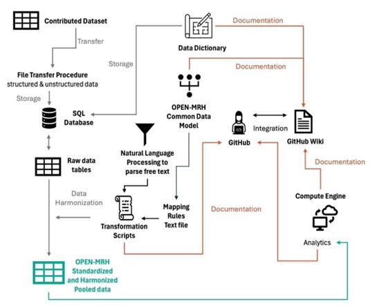

# [About]{#sec-About}

## Motivation

Medication-related harm (MRH) is a major yet under-addressed health challenge, causing approximately 197,000 annual deaths and €79 billion in healthcare costs in the EU alone ([@durand2024evaluating; @hakkarainen2012percentage; @donaldson2017medication]). Despite its importance, MRH research remains limited due to fragmented, inconsistent, and locally restricted datasets, often lacking standardized definitions, interoperability, or secure data sharing infrastructure. The OPEN-MRH project addresses these gaps by developing an internationally accessible, FAIR (Findable, Accessible, Interoperable, Reusable) platform and dataset for clinically adjudicated MRH. By aggregating high-quality datasets, developing consensus-based definitions, and leveraging secure infrastructure, OPEN-MRH will enable reproducible, cross-disciplinary research and support the development of targeted healthcare interventions to prevent MRH—ultimately improving patient outcomes and enhancing the safety of healthcare systems worldwide. OPEN-MRH directly supports the NPOS 2030 Ambition Document by advancing transparency, data reusability, and institutional collaboration, and aligns with the EOSC Multi-Annual Roadmap by delivering scalable, domain-specific infrastructure for real-world health data sharing and reuse.

------------------------------------------------------------------------

## Objection

------------------------------------------------------------------------

## Summary

The OPEN-MRH project will create an open, secure, and interoperable platform for medication-related harm (MRH) research. By harmonizing and pooling de-identified patient-level data from international studies, it will enable large-scale analysis of MRH and its causes. This platform will provide FAIR data, shared standards, and clear guidance for researchers and institutions navigating new EU AI regulations. OPEN-MRH will strengthen global collaboration, support safe use of medications, and promote transparency, reproducibility, and responsible data governance in patient safety research. Eventually, this project will improve patients' lives and contribute to better and more cost-effective health care by reducing unnecessary MRH in patients.

------------------------------------------------------------------------

## System architecture

{#fig-system_architecture}

------------------------------------------------------------------------

## Collaborators and affiliations

| Name                  | Affiliation                          |
|-----------------------|--------------------------------------|
| Daniala Weir          | Utrecht University                   |
| Fatma Karapinar       | University Medical Centre Maastricht |
| Veerle van Hulten     |                                      |
| Maarten Lambert       | Utrecht University                   |
| Rafael Coronado       |                                      |
| Lina Heier            | Maastricht University                |
| Robyn Tamblyn         | McGill University                    |
| Brooke Levis          | McGill                               |
| Corinne Hohl          | University of British Columbia       |
| Thomas Kempen         | Utrecht University                   |
| Joanna Klopotowska    | Amsterdam University Medical Centre  |
| Emily McDonald        | McGill                               |
| Lisa McCarthy         | University of Toronto                |
| Caitriona Cahir       | Royal College of Surgeons in Ireland |
| Ania Syrowatka        | Brigham and Womans Hospital          |
| Zuzanna Juhásová      | Charles University                   |
| Lorenz van der Linden | Katholieke Universiteit              |
| Olaf Klungel          | Utrecht University                   |
| Helga Gardarsdottir   | Utrecht University                   |
| Toine Egberts         | Utrecht University                   |
| Frans Huigen          | Utrecht University                   |
| Mercedes Beltran      | Utrecht University                   |
| Jelle Treep           | Utrecht University                   |
| Dawa Ometto           | Utrecht University                   |
| Patrick Souverein     | Utrecht University                   |
| Magdalena Gamba       | Utrecht University                   |
| Roosmarie Vriens      | Utrecht University                   |
